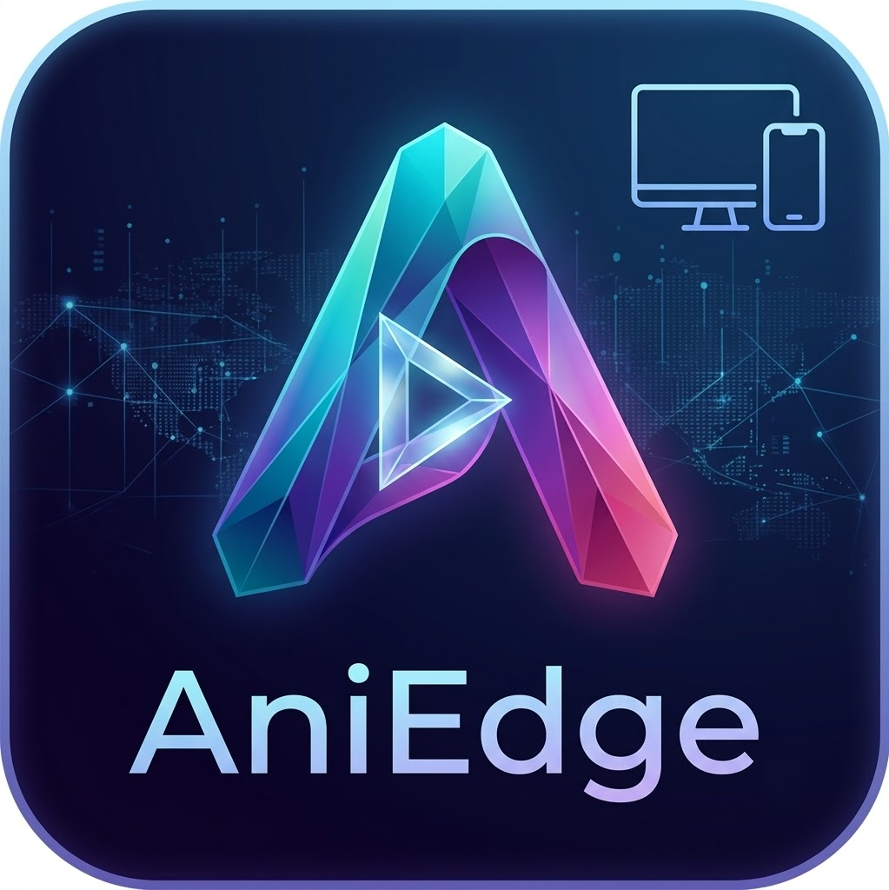
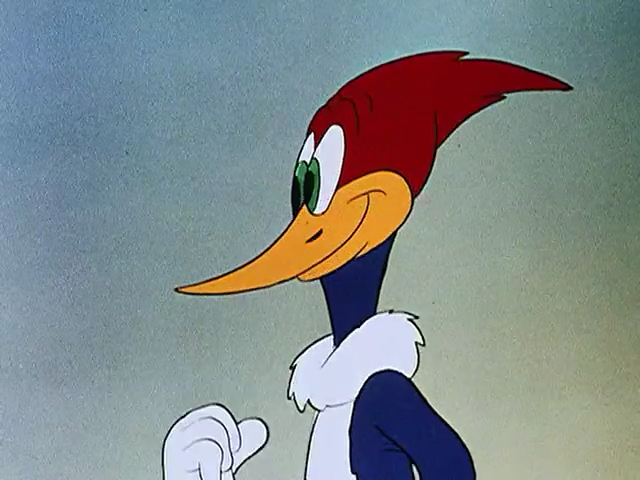

  
  <h1>AniEdge</h1>
  
<strong>오래된 애니메이션을, 더 또렷하게.</strong>

  
AMD Radeon을 위한 애니메이션 AI 업스케일링 플레이어

  
<code>Windows x64</code> <code>Radeon RX 9000</code> <code>AI 2×</code> <code>Portable</code>

  
<a href="https://github.com/KORTibetfox/AniEdge/releases/latest"><strong>최신 버전 다운로드</strong></a> · <a href="#원본과-비교하기">화질 비교</a> · <a href="#시작하기">시작하기</a>

---

## 오래된 애니메이션을 위한 플레이어

AniEdge는 **오래된 저해상도 애니메이션을 더 깨끗하고 또렷하게 감상하기 위해** 만들었습니다. PC에 저장된 영상을 AI로 가로·세로 각각 2배 확대하고, 거친 노이즈와 흐릿한 윤곽을 정돈해 재생합니다.

480p 이하의 오래된 영상에서 눈에 띄는 입자감, 뭉개진 선, 색 면의 얼룩을 줄이는 데 초점을 맞췄습니다. 원작의 그림과 분위기를 존중하면서, 큰 화면에서도 편하게 볼 수 있는 재생 경험을 목표로 합니다.

## 원본과 비교하기

같은 영상의 **동일한 프레임**을 원본과 AniEdge 출력으로 비교했습니다.

<table>
  <thead>
    <tr><th align="center">원본 · 640 × 480</th><th align="center">AniEdge · 1280 × 960</th></tr>
  </thead>
  <tbody>
    <tr>
      <td width="50%"></td>
      <td width="50%"></td>
    </tr>
    <tr><td align="center">배경과 색 면의 거친 입자감</td><td align="center">정돈된 배경 · 또렷한 얼굴과 부리의 윤곽</td></tr>
  </tbody>
</table>

**배경의 노이즈**, **눈과 부리의 선**, **머리와 몸통의 색 면**을 비교해 보세요. 이미지를 클릭하면 원래 해상도로 볼 수 있습니다.

비교 영상: The Barber of Seville (1944), 00:43 부근. 원본을 디코딩한 RGB 프레임과 그 프레임을 입력으로 사용한 v0.3.4의 실제 AI 출력입니다. 두 이미지는 같은 화면 크기로 표시하며, 비교용 추가 색 보정·샤프닝은 적용하지 않았습니다. 결과는 영상에 따라 다르며 미세 질감의 단순화와 일부 색 차이는 남을 수 있습니다.

## 주요 기능

| 기능 | 감상 경험 |
|---|---|
| **애니메이션 AI 2× 확대** | 저해상도 영상의 윤곽을 정돈하고 가로·세로를 각각 2배 확대합니다. |
| **노이즈 완화** | 오래된 영상의 거친 입자와 색 면의 노이즈를 줄입니다. |
| **음성과 외부 자막** | 음성 동기화와 SRT·ASS·SSA 외부 자막을 지원합니다. |

## 시작하기

1. [최신 릴리스](https://github.com/KORTibetfox/AniEdge/releases/latest)에서 **AniEdge-v0.3.4-Windows-x64.zip**을 다운로드합니다.
2. ZIP **전체를** 원하는 폴더에 압축 해제합니다.
3. `AniEdge.exe`를 실행합니다.
4. 영상 파일을 선택하거나 창으로 끌어 놓고 재생합니다.

실행 파일과 함께 제공되는 DLL 및 `models`, `scripts`, `vendor` 폴더를 유지하세요.

## 지원 환경

| 항목 | 내용 |
|---|---|
| 운영체제 | Windows x64, DirectX 12 지원 |
| 그래픽카드 | Radeon RX 9000 시리즈 자동 선택 · **RX 9070 XT에서 실행 검증** |
| 파일 | 로컬 MP4·MKV, CFR 영상 |
| 입력 | 짝수 폭·높이, 최대 2,073,600픽셀(1920 × 1080 상당) |
| 출력 | 입력의 가로·세로 각각 2배 |
| 자막 | 영상과 같은 이름의 외부 SRT·ASS·SSA 파일 |

RX 9070 XT에서 **1080p → 4K, 24fps 영상의 5분·7,200프레임 재생**을 확인했으며, 해당 조건에서 영상·디코더 드롭과 버퍼 대기는 0회였습니다. 다른 GPU와 영상의 성능은 달라질 수 있습니다.

단축키와 지원 범위 자세히 보기

| 입력 | 동작 |
|---|---|
| 탐색 막대 클릭·드래그 | 원하는 위치로 이동 |
| ← / → | 5초 전 / 후로 이동 |
| ↓ / ↑ | 30초 전 / 후로 이동 |
| PageDown / PageUp | 60초 전 / 후로 이동 |
| Home | 처음으로 이동 |
| Space | 일시정지 / 재생 |
| F | 전체화면 |
| Q | 재생 종료 |

탐색 후 새 프레임이 준비되는 짧은 대기가 있을 수 있습니다. 내장 자막·음성 트랙 선택, VFR·인터레이스 보정은 지원하지 않습니다. 다른 플레이어의 색 관리나 HDR·ICC 설정에 따라 화면의 색 표시가 달라질 수 있습니다.

---

자체 C++ 코드에는 MIT 라이선스가 적용됩니다. 외부 구성 요소와 모델·데이터에는 각각의 원래 조건이 적용되며, 배포 ZIP에 포함된 LICENSE와 THIRD_PARTY_NOTICES.md에서 확인할 수 있습니다.
